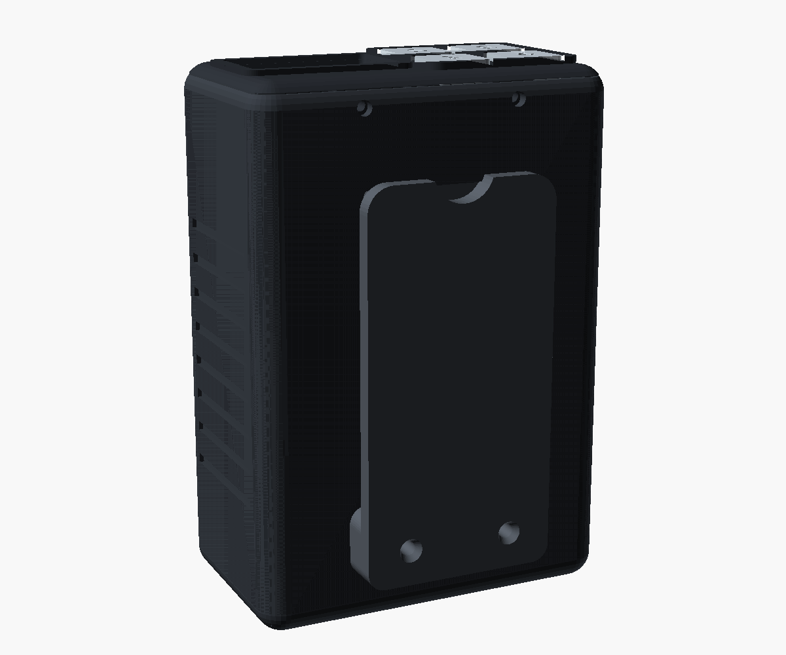
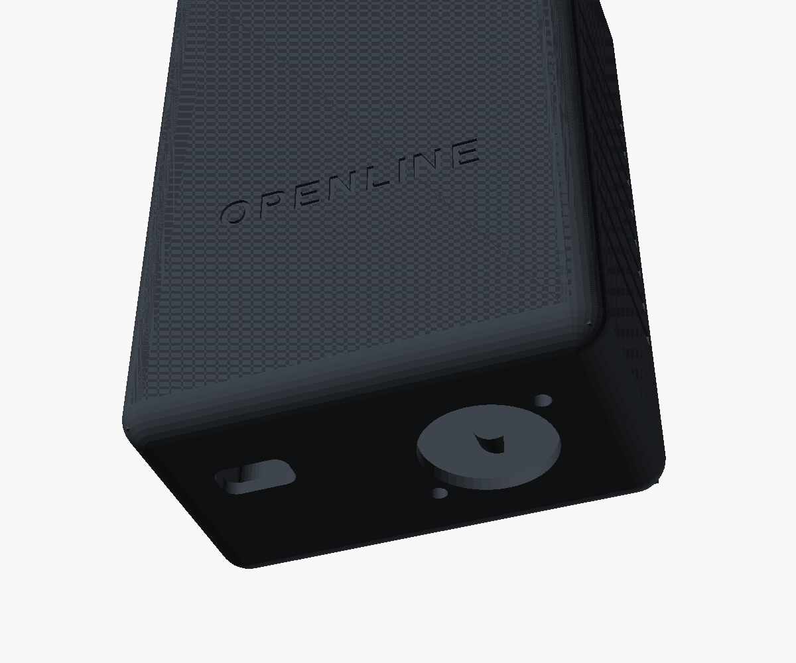

# Beltpack case, rev B (carrier-board prototype)

A 3D-printable case for the prototype, with the **screen and keys on the top edge**: you look down at them with the beltpack on your belt. It has a built-in 18650 battery, and the XLR-4 headset jack and USB-C are on the bottom. Also here: a belt clip, translucent lit key caps, and a 1- or 2-bay charging dock.

| | |
|---|---|
|  |  |
|  |  |

Outside size: **84 × 50 × 122 mm** (W × D × H, including the key caps). The design is parametric OpenSCAD:
- `params.scad` holds every dimension.
- `./build.sh` re-exports all STLs.
- `./render.sh` redraws these images.

> **Measure before printing.** Values marked `MEASURE` in `params.scad` depend on the exact modules you buy: USB-C port position, OLED stack height, switch height, XLR panel hole. Check them with calipers, then re-run `build.sh`. Print the **lid first** and test-fit the screen and keys; it's the quickest part and the most sensitive.

## Parts to print

| File | Qty | Material | Orientation |
|---|---|---|---|
| `stl/case_body.stl` | 1 | PETG (or PLA+) | standing up, open top up |
| `stl/case_lid.stl` | 1 | PETG | as exported (top face on the bed) |
| `stl/keycaps_x4.stl` | 1 set | **translucent** PETG/PLA | as exported (key tops on the bed) |
| `stl/belt_clip.stl` | 1 | **PETG** (it needs to flex) | flat |
| `stl/dock_1bay.stl` or `stl/dock_2bay.stl` | 1 | PLA/PETG | flat |

Settings: 0.2 mm layers, 3 walls, 20–25 % infill, no supports. On the body, turn on "ironing" or a 0.12 mm first layer for a cleaner bottom face.

## Hardware

- 4× **M3 × 8** pan-head screws: the lid, through the front and back walls into the lid's blocks.
- 2× **M3 heat-set inserts** (4.2 mm hole, 5 mm long) and 2× **M3 × 8 countersunk**: the belt clip.
- 3× **M2 × 5** screws: the control board, into the lid posts.
- 2× **M3 × 8** with nuts: the XLR jack (Neutrik D-size flange).
- An EC11 encoder with an **M7 threaded bushing** plus its nut, and a knob (6 mm D-shaft).
- A mini slide switch (SS12D00-style), soldered to the **front** of the main board so its knob pokes through the slot in the front face.
- An 18650 **holder with wire leads** (≈ 77 × 21 mm) and a **protected** 18650 cell.
- 4 stick-on rubber feet for the dock (10 mm).

## Inside the case

```
 top lid ── screen + 4 lit keys
   └─ control board (parts up): OLED, 4× 6×6×5 mm tactile switches,
      a WS2812 LED beside each switch under its cap
        │ 10-wire ribbon: 3V3, 5V, GND, SDA, SCL, KEY1-4, LED DIN
 main board (stands upright in the side rails, parts on the back):
      ESP32-S3 DevKit (USB-C at the bottom edge), WM8960 codec board,
      18650 charger + 5 V boost module, power switch on the front side
 battery tray (against the back wall) ── 18650 in its holder
 bottom ── XLR-4 (wired to the codec) · USB-C (DevKit's port)
 knob ── EC11 through the side wall (wearer's right), 4 wires to the main board
```

Pins are the same as the build guide and `firmware/main/board.h`. Only the physical arrangement changed.

**Battery wiring:** 18650 → charger/boost module input (B+ / B−). Module 5 V out → power switch → DevKit **5V** pin. Charging comes in through the DevKit's USB-C, so the dock works. Wire the module's 5 V input to the DevKit's 5 V/VBUS pad, on the USB side of the switch, so it charges with the switch off too. If your module has a "charged/charging" pin, wire it to GPIO 44 so the admin page shows charging.

**Screen orientation:** fit the OLED so its text reads from the belt side, which is the wearer's view. If it comes out upside down, turn the module 180°.

## PCB outlines (for KiCad)

`control_board_outline.dxf` and `main_board_outline.dxf` are the two board shapes, with the control board's three M2 holes. Import each into KiCad's PCB editor (File → Import → Graphics, layer *Edge.Cuts*).

Where things sit on the control board, measured from its bottom-left corner as seen from above: subtract `cb_x[0]` and `cb_y[0]` from the case coordinates in `params.scad`. The key centres are `keys`, and the screen window centre is `oled_c`.

## Docking

1. Push a USB-C cable's plug up through the slot in the dock floor from underneath, until its plastic body stands **4 mm** (`usb_mouth`) above the pocket floor.
2. Hot-glue it from below, then run the cable along the groove.
3. **Unplug the headset before docking**, because the XLR is on the bottom too.

The pocket holds the beltpack upright, and the notch at the back takes the belt clip.
