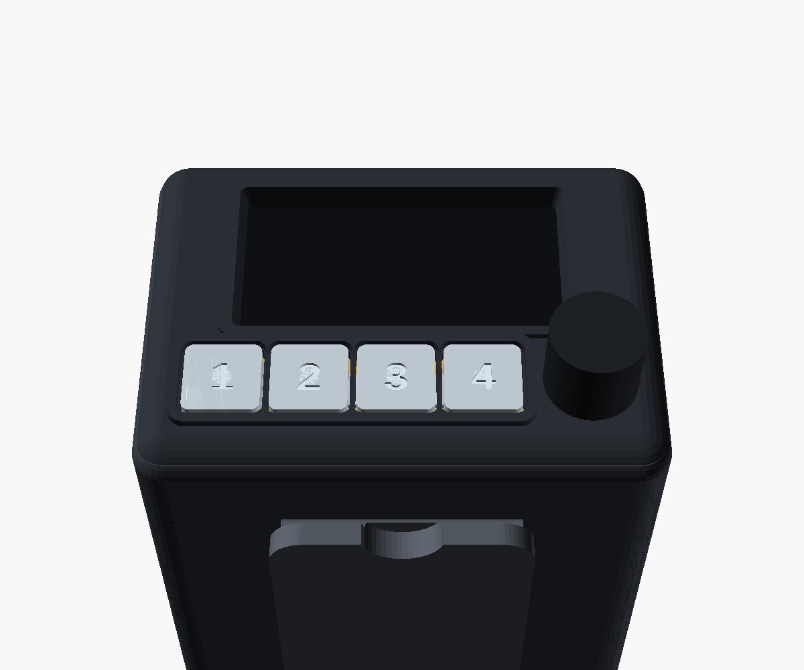
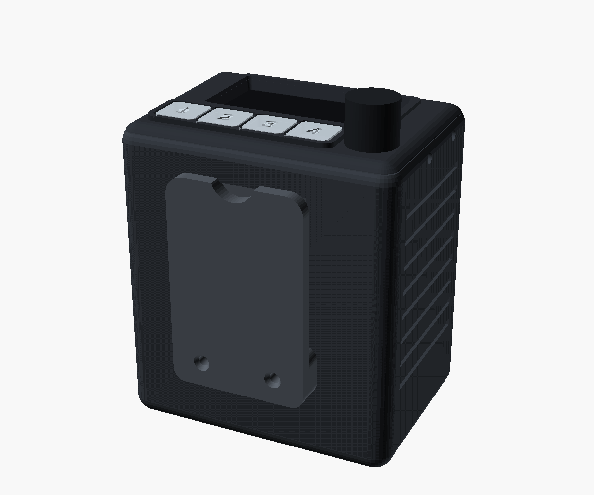
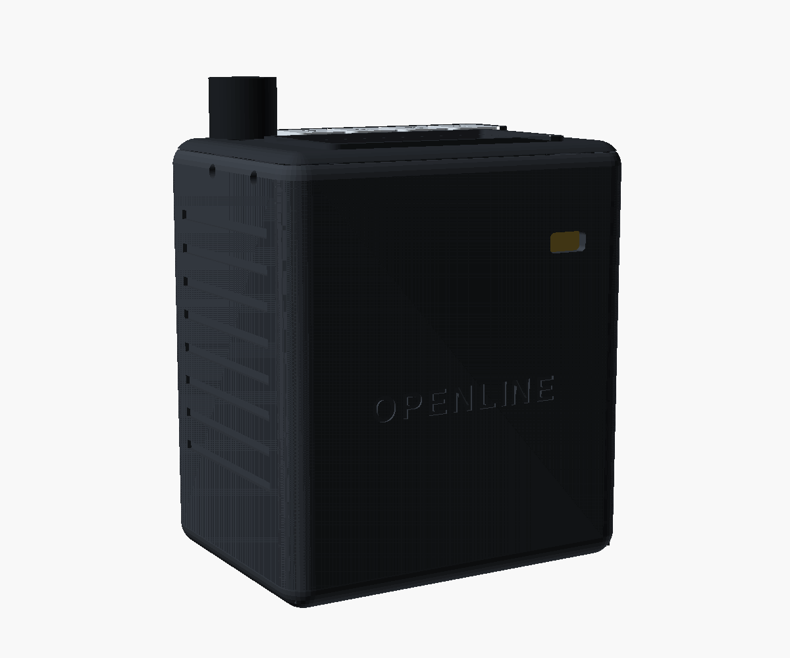
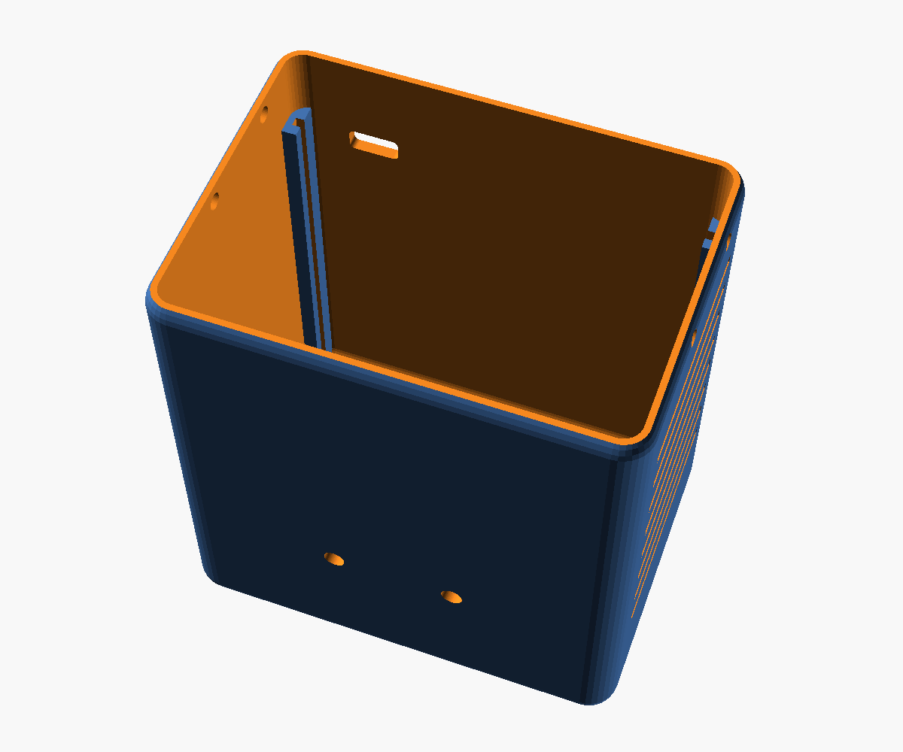
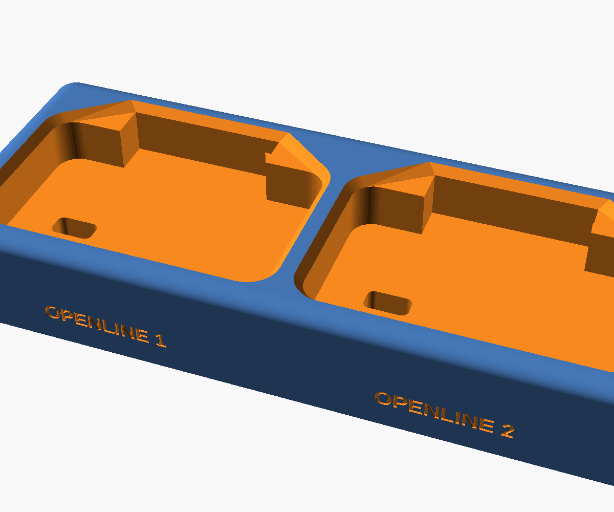

# Beltpack case, rev D (carrier-board prototype)

A 3D-printable case for the prototype with the **"Beltpack 3" mockup on the top face**. With the beltpack on your belt, you look down at a **2.42" screen**, the **4 lit talk keys** in a row under it, and the **volume knob** at the end of the row. It has a built-in 18650 battery, and the XLR-4 headset jack and USB-C are on the bottom. Also here: a belt clip, translucent lit key caps, and a 1- or 2-bay charging dock.

| | |
|---|---|
|  |  |
|  |  |
|  |  |

Outside size: **90 × 66 × 102 mm** (W × D × H, plus the key caps and knob on top and the clip on the back). It's deeper than earlier revisions so the big screen *and* the key row both fit on the top face.

The design is parametric OpenSCAD:
- `params.scad` holds every dimension.
- `./build.sh` re-exports all STLs and the PCB outlines.
- `./render.sh` redraws these images.

> **Measure before printing.** Values marked `MEASURE` in `params.scad` depend on the exact modules you buy: the OLED's window position and stack height, switch height, USB-C port position, and the XLR panel hole. Check them with calipers, then re-run `build.sh`. Print the **lid first** and test-fit the screen and keys. It's the quickest part and the most sensitive.

## Top face (wearer's view)

```
        far edge (front of the beltpack)
 ┌──────────────────────────────────────────┐
 │    ┌────────────────────────────────┐    │
 │    │   2.42" OLED  (55 × 28 mm)     │    │
 │    └────────────────────────────────┘    │
 │   ┌───┐ ┌───┐ ┌───┐ ┌───┐     ╭───╮      │
 │   │ 1 │ │ 2 │ │ 3 │ │ 4 │     │knob│     │
 │   └───┘ └───┘ └───┘ └───┘     ╰───╯      │
 └──────────────────────────────────────────┘
        near edge (belt side, toward you)
```

## Parts to print

| File | Qty | Material | Orientation |
|---|---|---|---|
| `stl/case_body.stl` | 1 | PETG (or PLA+) | standing up, open top up |
| `stl/case_lid.stl` | 1 | PETG | as exported (top face on the bed) |
| `stl/keycaps_x4.stl` | 1 set | **translucent** PETG/PLA | as exported (key tops on the bed) |
| `stl/belt_clip.stl` | 1 | **PETG** (it needs to flex) | flat |
| `stl/dock_1bay.stl` or `stl/dock_2bay.stl` | 1 | PLA/PETG | flat |

Settings: 0.2 mm layers, 3 walls, 20–25 % infill, no supports. On the body, turn on "ironing" or use a 0.12 mm first layer for a cleaner bottom face.

## Hardware

- **2.42" 128×64 OLED, SSD1309, 4-pin I2C version** (GND VCC SCL SDA, ≈ 61 × 37 mm). Some sellers ship these set to SPI; get the I2C one, or move the resistor jumpers as the listing describes.
- **EC11 encoder** with push switch, M7 threaded bushing and a **20 mm shaft** (15 mm is too short to reach a knob through the lid), plus a knob that matches its shaft (6 mm knurled/"plum" or D-shaft), ≈ 15–20 mm across. It's soldered to the control board, which is screwed to the lid; the bushing comes up through the lid, so the nut is optional.
- 4× **6 × 6 × 5 mm tactile switches** and 4× **WS2812** LEDs (one beside each switch, under its cap).
- 4× **M3 × 8** pan-head screws: the lid, through the side walls into the lid's blocks.
- 3× **M2 × 5** screws: the control board, into the lid posts.
- 2× **M3 heat-set inserts** (4.2 mm hole, 5 mm long) and 2× **M3 × 8 countersunk**: the belt clip.
- 2× **M3 × 8** with nuts: the XLR jack (Neutrik D-size flange).
- A mini slide switch (SS12D00-style), soldered to the **front** of the main board so its knob pokes through the slot in the front face.
- An 18650 **holder with wire leads** (≈ 77 × 21 mm) and a **protected** 18650 cell.
- 4 stick-on rubber feet for the dock (10 mm).

## Inside the case

```
 lid (top face) ── 2.42" screen · 4 lit keys · knob
   └─ control board (parts up): OLED on a short header, 4× 6×6×5 mm switches,
      a WS2812 beside each switch, EC11 encoder
        │ 12-wire ribbon: 3V3, 5V, GND, SDA, SCL, KEY1-4, ENC A/B/SW, LED DIN
 main board (stands upright in the side rails, parts on the back, ≤ 30 mm deep):
      ESP32-S3 DevKit (USB-C at the bottom edge), WM8960 codec board,
      18650 charger + 5 V boost module, power switch on the front side
 battery ── 18650 holder lying across the floor against the back wall
 bottom ── XLR-4 (wired to the codec) · USB-C (DevKit's port)
```

Pins are the same as the build guide and `firmware/main/board.h`. Only the physical arrangement changed.

**Battery wiring:** 18650 → charger/boost module input (B+ / B−). Module 5 V out → power switch → DevKit **5V** pin. Charging comes in through the DevKit's USB-C, so the dock works. Wire the module's 5 V input to the DevKit's 5 V/VBUS pad, on the USB side of the switch, so it charges with the switch off too. If your module has a "charged/charging" pin, wire it to GPIO 44 so the admin page shows charging.

**Screen:** the firmware defaults to the 2.42" SSD1309 (`idf.py menuconfig` → *OpenLine beltpack* → *Display*). The text should read from the belt side, which is the wearer's view. If it comes out upside down, turn on *Rotate OLED 180 degrees* in the same menu. There's no need to turn the module.

## PCB outlines (for KiCad)

`control_board_outline.dxf` and `main_board_outline.dxf` are the two board shapes, with the control board's three M2 holes. Import each into KiCad's PCB editor (File → Import → Graphics, layer *Edge.Cuts*).

Where things sit on the control board, measured from its bottom-left corner as seen from above with the front edge at the bottom: subtract `cb_x[0]` and `cb_y[0]` from the case coordinates in `params.scad`. The key centres are `keys`, the encoder is `enc_c`, and the screen window centre is `oled_c`.

## Docking

1. Push a USB-C cable's plug up through the slot in the dock floor from underneath, until its plastic body stands **4 mm** (`usb_mouth`) above the pocket floor.
2. Hot-glue it from below, then run the cable along the groove.
3. **Unplug the headset before docking**, because the XLR is on the bottom too.

The pocket holds the beltpack upright. The belt clip starts above the pocket, so the dock doesn't need a notch for it.
